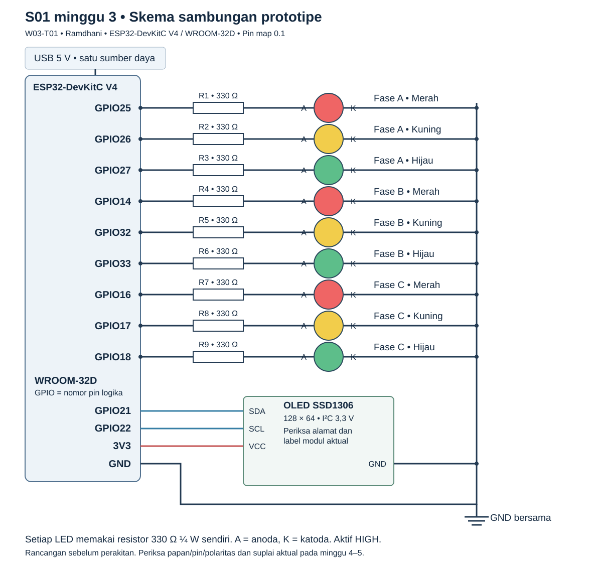

# LLD rangkaian dan pengendalian ESP32

| Identitas | Nilai |
|---|---|
| Tim / sprint / minggu | KELOMPOK-10 / S01 / 3 |
| Tugas / PIC | W03-T01 / Ramdhani |
| Versi / tanggal | 0.1 / 29 Oktober 2026 |
| Status | Rancangan tersedia untuk review; belum merupakan bukti perakitan atau uji fisik |
| Lokasi | `KELOMPOK-10/docs/perangkat/perakitan.md` |

## 1. Acuan dan komponen

Rancangan melanjutkan SRS Bagian 5 dan HLD Bagian 4.3, dengan ESP32-DevKitC V4 berisi ESP32-WROOM-32D, 9 LED (3 merah, 3 kuning, 3 hijau), 9 resistor 330 Ω ¼ W, OLED SSD1306 I²C 128 × 64, breadboard, jumper, serta adaptor USB 5 V 2 A. Papan aktual diperiksa pada minggu 4 dan dirakit pada minggu 5.

Penetapan GPIO berikut merupakan keputusan rancangan minggu 3. Nomor adalah **nomor GPIO**, bukan urutan lubang breadboard. Rujukan header dan pilihan satu sumber daya mengikuti [panduan resmi ESP32-DevKitC](https://docs.espressif.com/projects/esp-dev-kits/en/latest/esp32/esp32-devkitc/user_guide.html), diakses 29 Oktober 2026. GPIO16/17 di sini mensyaratkan modul WROOM; papan WROVER memerlukan pemetaan ulang.

## 2. Skema dan tabel sambungan

Setiap cabang LED: GPIO → resistor masing-masing → anoda LED (A) → katoda (K) → GND bersama. Resistor seri boleh ditempatkan di sisi anoda atau katoda dengan sambungan seri tetap. Logika aktif HIGH: 1 menyala, 0 padam.

| Fase / beban | GPIO / label papan | Resistor | Terminal akhir |
|---|---|---|---|
| A merah | 25 / IO25 | R1 330 Ω | Anoda A-M; katoda ke GND |
| A kuning | 26 / IO26 | R2 330 Ω | Anoda A-K; katoda ke GND |
| A hijau | 27 / IO27 | R3 330 Ω | Anoda A-H; katoda ke GND |
| B merah | 14 / IO14 | R4 330 Ω | Anoda B-M; katoda ke GND |
| B kuning | 32 / IO32 | R5 330 Ω | Anoda B-K; katoda ke GND |
| B hijau | 33 / IO33 | R6 330 Ω | Anoda B-H; katoda ke GND |
| C merah | 16 / IO16 | R7 330 Ω | Anoda C-M; katoda ke GND |
| C kuning | 17 / IO17 | R8 330 Ω | Anoda C-K; katoda ke GND |
| C hijau | 18 / IO18 | R9 330 Ω | Anoda C-H; katoda ke GND |
| OLED SDA | 21 / IO21 | Pull-up modul diperiksa | SDA OLED |
| OLED SCL | 22 / IO22 | Pull-up modul diperiksa | SCL OLED |
| OLED VCC | 3V3 | — | VCC modul yang mendukung 3,3 V |
| OLED GND | GND | — | GND bersama |
| Daya papan | Micro-USB | — | Adaptor USB 5 V 2 A atau USB PC saat pemrograman |

GPIO pada tabel tidak tumpang tindih. Jalur flash, UART pemrograman, dan pin input-only tidak dipakai untuk LED. LED langsung di GPIO hanya untuk prototipe indikator ini. GPIO/OLED memakai logika 3,3 V. Periksa pinout OLED aktual dan pull-up I²C ke 3,3 V, lalu pindai alamat perangkat; alamat tidak diasumsikan pasti 0x3C. GPIO14 yang dipakai LED tidak dipakai JTAG bersamaan.

**Perhitungan rancangan, bukan pengukuran:** untuk contoh Vf LED 2,0 V, arus cabang ≈ (3,3 − 2,0)/330 = 3,94 mA dan daya resistor ≈ 5,12 mW. Vf/kecerahan, konsumsi papan/OLED, tegangan rail, serta kecukupan sumber USB diperiksa pada perangkat aktual. Rating 2 A adalah kapasitas adaptor, bukan arus yang dipaksakan ke ESP32.

## 3. Daya dan langkah perakitan

1. Catat jenis modul/papan dan label pin; cocokkan tabel sebelum menyambung.
2. Dalam keadaan tanpa daya, hubungkan GND papan ke rail GND breadboard. Satukan rail yang terputus bila dipakai.
3. Pasang sembilan resistor seri dan LED sesuai tabel; periksa polaritas serta tidak adanya hubungan singkat 3V3–GND.
4. Hubungkan OLED VCC 3V3, GND, SDA21, SCL22 sesuai label modul aktual.
5. Pasok papan melalui **satu sumber**: micro-USB adaptor saat operasi atau USB PC saat pemrograman. Jangan menggabungkan suplai USB, pin 5V, dan pin 3V3 sekaligus.
6. Firmware mengatur semua keluaran padam sebelum menetapkan merah ketiga fase. Keadaan pin selama reset/sebelum firmware berjalan belum menjamin merah menyala; uji fisik mencatat perilakunya.
7. Lakukan uji satu LED per pin, pemindaian/tampilan OLED, urutan transisi, dan daya. Isi bukti aktual minggu 5; foto/rekaan hasil tidak disertakan dalam rancangan ini.

## 4. Tabel keluaran lampu

M = merah, K = kuning, H = hijau. Setiap sel berisi `(M,K,H)`.

| Keadaan | A | B | C | Durasi / peralihan |
|---|---|---|---|---|
| STARTUP_ALL_RED | (1,0,0) | (1,0,0) | (1,0,0) | 1 detik nominal setelah inisialisasi; lanjut A hanya dengan statis lokal sah |
| GREEN_A | (0,0,1) | (1,0,0) | (1,0,0) | g_A terkunci; pemicu B saat sisa 1 detik |
| YELLOW_A | (0,1,0) | (1,0,0) | (1,0,0) | 3 detik; kunci B sebelum merah bersama |
| ALL_RED_TO_B | (1,0,0) | (1,0,0) | (1,0,0) | 1 detik; lanjut GREEN_B |
| GREEN_B | (1,0,0) | (0,0,1) | (1,0,0) | g_B terkunci; pemicu C saat sisa 1 detik |
| YELLOW_B | (1,0,0) | (0,1,0) | (1,0,0) | 3 detik; kunci C |
| ALL_RED_TO_C | (1,0,0) | (1,0,0) | (1,0,0) | 1 detik; lanjut GREEN_C |
| GREEN_C | (1,0,0) | (1,0,0) | (0,0,1) | g_C terkunci; pemicu A saat sisa 1 detik |
| YELLOW_C | (1,0,0) | (1,0,0) | (0,1,0) | 3 detik; kunci A |
| ALL_RED_TO_A | (1,0,0) | (1,0,0) | (1,0,0) | 1 detik; lanjut GREEN_A |
| CONFIG_FAULT | (1,0,0) | (1,0,0) | (1,0,0) | Tetap merah setelah GPIO siap; alasan ditampilkan jika OLED tersedia |

Startup 1 detik dan CONFIG_FAULT adalah pilihan LLD; tidak mengganti kuning/merah bersama pada siklus normal. Operasi membutuhkan statis lokal yang sah dan telah diverifikasi. Nominal satu putaran = g_A + g_B + g_C + 12 detik. Satu detik sisa hijau pemicu sudah termasuk g fase aktif.

## 5. Mesin keadaan, timer, dan lock

Gunakan timer monotonic lokal dan deadline absolut; komunikasi, render OLED, serta penulisan log tidak boleh memblokir pergantian. `remaining_s = ceil(max(0, deadline_ms − now_ms)/1000)`. Kirim tepat satu pemicu saat timer melintasi sisa 1000 ms untuk giliran berikutnya; tandai sudah dikirim. Jika loop melewati batas, catat keterlambatan dan jangan mengirim dua pemicu. Penanganan wrap/reset timer harus didukung implementasi.

Saat hijau berakhir, padamkan hijau sebelum menyalakan kuning. Saat kuning berakhir, jalankan lock secara atomik sebelum mengubah keluaran ke semua merah. Callback MQTT dan lock memakai antrian/critical section yang sama: penerimaan pada/sesudah lock tidak masuk kandidat. Saat merah bersama selesai, padamkan keluaran fase tujuan lalu terapkan hijau dengan fase lain merah. Invarian: maksimal satu hijau dan satu lampu menyala per fase pada keadaan normal; perpindahan boleh sesaat padam, tidak menimbulkan dua hijau.

| Relatif terhadap pemicu | Kejadian nominal |
|---|---|
| 0 ms | Pemicu dikirim, hijau aktif tersisa 1 detik |
| 1000 ms | Kuning mulai |
| ≤3000 ms | Target penerimaan plan valid |
| <4000 ms, sebelum lock aktual | Plan valid masih boleh menjadi kandidat; bila >3000 ms target respons gagal |
| Sekitar 4000 ms | Lock lalu merah bersama mulai |
| Sekitar 5000 ms | Hijau fase berikutnya mulai |

Lock memakai keadaan dan waktu lokal aktual, bukan penjumlahan timestamp server. Toleransi timing belum ditetapkan; Ramdhani/Ikrom mencatat metode/resolusi alat serta toleransi sebelum uji, tanpa mengubah target respons 3000 ms. Rincian identitas dan validasi mengikuti `KELOMPOK-10/docs/operasional/konfigurasi-backend-dan-mqtt.md`.

## 6. Statis, pemulihan, sesi, dan OLED

- Pada lock, gunakan kandidat adaptif valid yang telah diterima. Jika tidak ada, gunakan durasi statis lokal fase tujuan yang sah; kegagalan jaringan/server tidak menghentikan timer selama ESP32/daya tetap hidup.
- Jika durasi statis lokal belum sah, jangan mulai giliran hijau; setelah GPIO siap masuk CONFIG_FAULT. Angka statis 15 detik dalam contoh konfigurasi hanya demonstrasi, belum diverifikasi.
- Plan identik memakai kembali ACK awal tanpa mereset kandidat/timer. Plan baru setelah lock ditolak. Pemulihan adaptif berlaku pada giliran sah berikutnya, tanpa memotong hijau aktif.
- Setiap boot menghasilkan `session_id` baru; `turn_id` naik pada setiap hijau aktif, tidak diulang dalam sesi. Giliran pertama berjalan statis, lalu pemicu mengacu giliran berikutnya. Reboot tidak melanjutkan timer lama dan menolak pesan sesi sebelumnya.
- OLED menampilkan fase/lampu aktual, sisa detik dan mode, N, k, kategori, serta satuan `kend/km/lajur`. Data N/k/kategori terkait **plan yang digunakan** pada giliran aktif, bukan kandidat berikutnya. Saat statis tanpa data, tampilkan `--`; nol hanya untuk pengukuran valid. Pada semua merah, tampilkan keadaan transisi dan fase sebelumnya/tujuan dengan label jelas.

## 7. Pemeriksaan berikutnya dan rekam perubahan

| Pemeriksaan | PIC / tahap | Bukti saat dilaksanakan |
|---|---|---|
| Kecocokan papan, resistor, polaritas, daya dan OLED | Ramdhani / minggu 4–5 | Inventaris, foto, catatan sambungan aktual |
| GPIO/LED/OLED, satu hijau, kuning/merah bersama | Ramdhani + Ikrom / minggu 5 dan uji integrasi | UJI-01, UJI-12, UJI-20; rekaman dan tabel ukur |
| Pemicu, respons, lock, statis, pemulihan/duplikasi | Ramdhani + Putu + Ikrom / integrasi | UJI-04, UJI-13–UJI-19 |

Perubahan pin/perangkat setelah review dicatat dengan alasan, versi pin map, firmware/config terdampak, dan uji ulang terkait. Status dokumen saat ini: rancangan lengkap, belum diuji pada perangkat.
