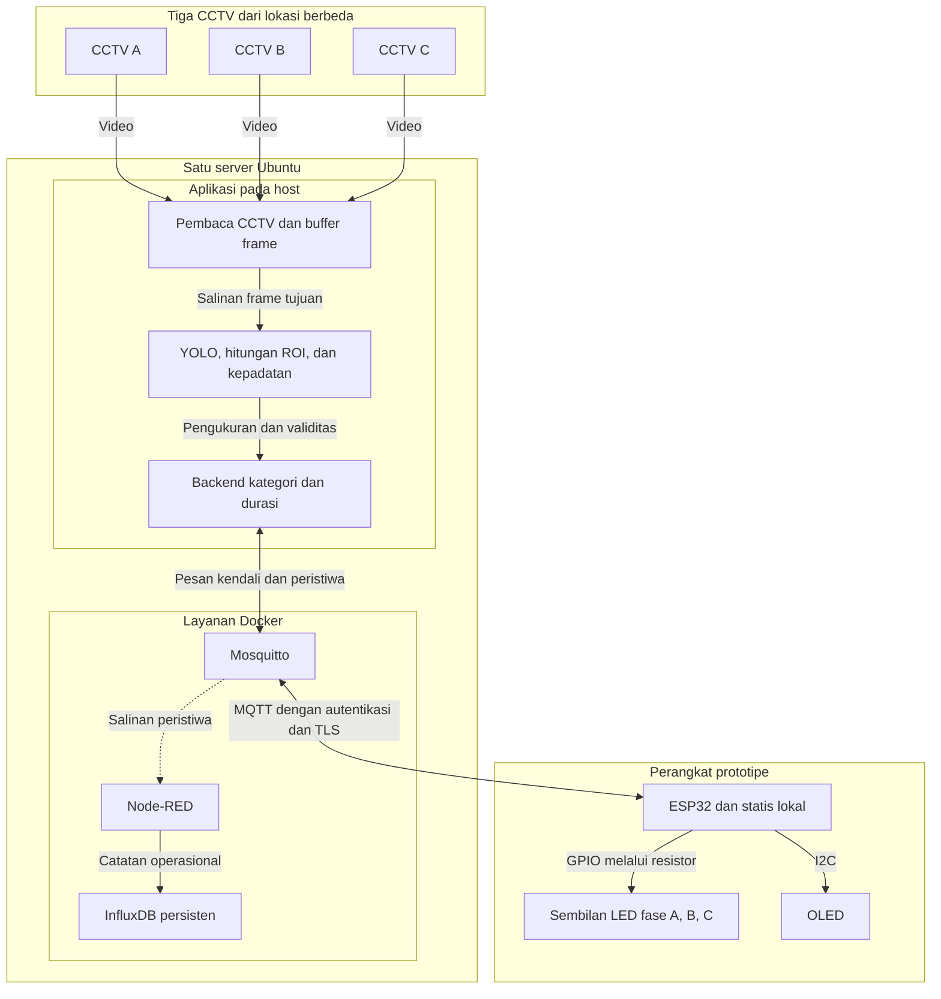
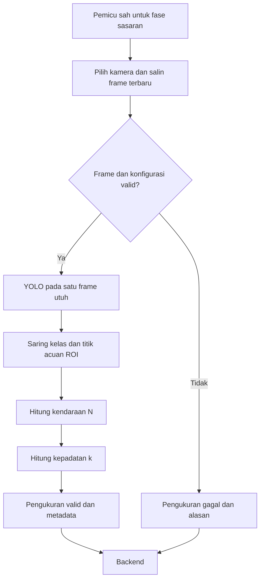
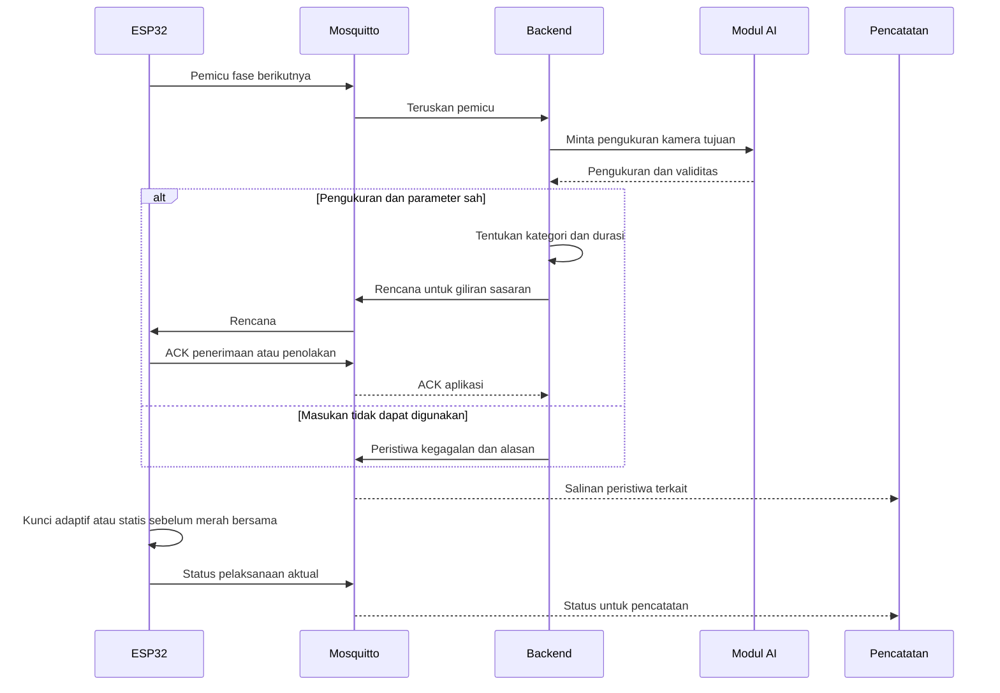
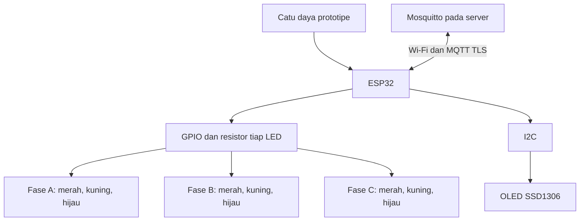
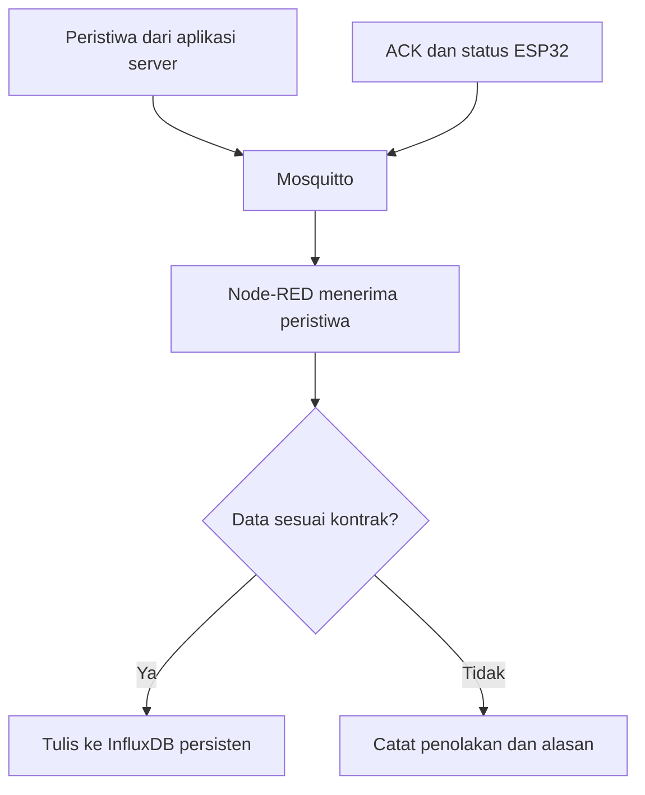

# High-Level Design — Rancangan Tingkat Tinggi Sistem

## Identitas dokumen

| Keterangan | Isi |
|---|---|
| Proyek | Estimasi Kepadatan Kendaraan dari CCTV untuk Pengendalian Lampu Lalu Lintas Adaptif pada Prototipe IoT |
| Tim | KELOMPOK-10 |
| Sprint / minggu | S01 / minggu 2 |
| Kode pekerjaan | W02-T01–W02-T05 — HLD lengkap seluruh anggota |
| Koordinator dokumen | Nicy Putra Pratama |
| Versi / tanggal | 0.2 / 29 Oktober 2026 |
| Status | Isi HLD seluruh anggota lengkap dan tergabung; siap Review PM |
| Lokasi | `KELOMPOK-10/docs/perencanaan/hld.md` |

## 1. Tujuan dan acuan

HLD menjelaskan penempatan komponen, pembagian fungsi, hubungan data, dan pengendalian agar anggota mempunyai acuan bersama sebelum menyusun rancangan terperinci dan implementasi.

| Acuan | Bagian yang digunakan |
|---|---|
| Proposal sempro `FINAL INI A(1).docx` | Bab 4 untuk kebutuhan; Subbab 5.1.1–5.1.4 serta Tabel 5.1–5.3 untuk arsitektur, dekomposisi, data, dan integrasi; Bab 6 untuk sasaran verifikasi. |
| `KELOMPOK-10/docs/perencanaan/srs.md` | Ruang lingkup, pembagian fungsi, KF/KNF, antarmuka, data, dan keputusan terbuka. |
| `KELOMPOK-10/docs/perencanaan/pembagian-kerja.md` | Pembagian W02-T01–W02-T05 dan ketergantungan pekerjaan. |
| `KELOMPOK-10/docs/perencanaan/matriks-kebutuhan.md` | Keterkaitan kebutuhan, verifikasi, serta parameter yang belum ditetapkan. |

Dokumen ini menerjemahkan kebutuhan menjadi rancangan tingkat tinggi. Rincian pin, topic, field JSON, toleransi timing, serta prosedur teknis diperinci pada pekerjaan minggu 3 dengan mengacu pada proposal. Varian/bobot YOLO dan parameter kalibrasi belum ditetapkan sebagai nilai final melalui HLD ini.

## 2. Lingkup dan pembagian penyusunan

Produk adalah prototipe tiga fase virtual A/B/C dengan sembilan LED dan OLED. Tiga CCTV berasal dari lokasi berbeda dan dipetakan ke fase virtual; sumber tersebut tidak dinyatakan sebagai tiga pendekat fisik pada satu persimpangan nyata. Pengamatan pagi, siang, dan sore mengikuti batasan pada SRS. Penerapan langsung pada lampu jalan umum berada di luar cakupan prototipe.

Satu berkas HLD memuat seluruh hasil W02-T01–W02-T05. Bagian 3 menjadi arsitektur bersama; Bagian 4.1–4.4 merinci setiap bidang dan sudah berisi diagram serta uraian. Nama PIC menunjukkan penanggung jawab teknis sesuai pembagian kerja. Paket ini menyusun seluruh bagian berdasarkan proposal/SRS; penerimaan PM dicatat setelah pemeriksaan.

| ID tugas | PIC | Bagian dan hasil yang tersedia | Status dokumen |
|---|---|---|---|
| W02-T01 | Nicy Putra Pratama | Arsitektur keseluruhan, fungsi server/perangkat, data/antarmuka, kondisi gagal, serta penyatuan HLD. | Review — isi tersedia. |
| W02-T02 | Rizky Bintang Fadillah | Diagram CCTV/AI, masukan/keluaran, frame/ROI, deteksi, hitungan, dan kepadatan pada Bagian 4.1. | Review — isi tersedia. |
| W02-T03 | Putu Radit Ardika | Diagram komunikasi, kategori/durasi, MQTT, rencana, ACK/status, serta aturan waktu pada Bagian 4.2. | Review — isi tersedia. |
| W02-T04 | Ramdhani | Diagram blok ESP32, lampu/OLED, timer/lock, statis, dan pemulihan pada Bagian 4.3. | Review — isi tersedia. |
| W02-T05 | Ikrom Safei | Diagram pencatatan, kelompok data, identitas, persistensi, dan independensi kendali pada Bagian 4.4. | Review — isi tersedia. |

## 3. Arsitektur Sistem — Nicy

### 3.1 Pembagian lingkungan

Sistem terdiri atas sumber video, satu server, jaringan komunikasi, dan perangkat prototipe. Server dapat ditempatkan pada cloud atau lingkungan pengguna sesuai kebutuhan pada SRS Bagian 5.

- **Host Ubuntu:** pembaca CCTV, buffer frame, modul AI YOLO, penghitungan/kepadatan, serta backend.
- **Layanan Docker pada server yang sama:** Mosquitto, Node-RED, dan InfluxDB.
- **ESP32:** pelaksana timer/urutan lampu, penerima dan validator rencana, penguncian, statis cadangan lokal, OLED, serta pengirim pemicu/ACK/status.

Kalibrasi kategori dan durasi dijalankan secara offline menggunakan data pengamatan. Backend menggunakan hasil kalibrasi yang telah disimpan; K-means tidak dijalankan ulang setiap kali fase berganti.

### 3.2 Diagram arsitektur keseluruhan



Diagram menunjukkan penempatan dan hubungan komponen, bukan urutan waktu eksekusi. Garis putus-putus ke Node-RED menandai salinan peristiwa untuk pencatatan. Backend mengirim rencana tanpa menunggu penulisan InfluxDB; keputusan pengendalian tetap dilaksanakan oleh ESP32.

Video dibaca melalui koneksi sumber CCTV. MQTT membawa pesan/metadata JSON, bukan video. Alur utama pengukuran AI ke backend menggunakan antarmuka internal aplikasi sesuai Tabel 5.3 proposal; publikasi pengukuran untuk pencatatan diselaraskan pada kontrak komunikasi.

### 3.3 Fungsi komponen, masukan, dan keluaran

| Komponen | Masukan | Fungsi dan keluaran | PIC teknis |
|---|---|---|---|
| Konfigurasi pengamatan | Sumber/fase, ROI, panjang, lajur, dimensi, dan informasi waktu. | Menyediakan konfigurasi pengamatan yang valid dan identitas versinya. | Rizky; Ikrom untuk metadata. |
| Pembaca CCTV dan buffer | Tiga koneksi video. | Memperbarui frame tiap kamera beserta identitas/waktu; menyediakan salinan frame terbaru untuk kamera tujuan. | Rizky. |
| AI dan pengukuran | Salinan frame serta konfigurasi pengamatan. | Memvalidasi masukan, mendeteksi empat kelas kendaraan dengan YOLO, menyaring ROI, menghitung kendaraan dan kepadatan, lalu mengirim nilai/status. | Rizky. |
| Kalibrasi offline | Hitungan manual, panjang/lajur, metadata sampel, dan pengamatan layanan kelompok awal per kamera. | Menghasilkan pusat kelompok, K1/K2, durasi kategori, dasar/tambahan, dan catatan asal parameter. | Putu; Rizky/Ikrom menyediakan data. |
| Backend | Pemicu fase, hasil pengukuran, dan parameter hasil kalibrasi. | Memvalidasi identitas/data, menentukan kategori, menghitung durasi dalam batas, dan mengirim rencana fase berikutnya. | Putu. |
| Mosquitto | Pesan pemicu, rencana, ACK, status, dan publikasi peristiwa terkait. | Menghubungkan penerbit/pelanggan MQTT sesuai kontrak, autentikasi, dan TLS. | Putu; Ramdhani untuk klien ESP32. |
| ESP32 | Rencana adaptif serta konfigurasi statis lokal. | Mengirim pemicu, memvalidasi kandidat, melakukan lock, menjalankan timer/urutan, serta mengirim ACK/status. | Ramdhani; Putu untuk kesesuaian parameter. |
| LED dan OLED | Keluaran GPIO dan informasi dari firmware. | Memperagakan urutan tiga fase dan menampilkan keadaan aktual serta data rencana yang digunakan. | Ramdhani. |
| Node-RED dan InfluxDB | Peristiwa pengukuran/pengendalian beserta ID/waktu/versi. | Mengalirkan dan menyimpan catatan persisten untuk penelusuran/evaluasi. | Ikrom; Putu untuk layanan/volume. |

### 3.4 Batas tanggung jawab server dan perangkat

| Fungsi | Tanggung jawab server | Tanggung jawab ESP32 |
|---|---|---|
| Pengamatan | Membaca CCTV dan menyediakan frame kamera tujuan. | Menentukan giliran/fase tujuan melalui pemicu. |
| Pengukuran | Menjalankan YOLO, aturan ROI, hitungan, kepadatan, dan validasi masukan. | Menggunakan data rencana terkait untuk tampilan/status; tidak menjalankan deteksi video. |
| Penentuan durasi | Memakai parameter kalibrasi dan batas untuk membentuk kandidat rencana. | Memvalidasi kandidat dan memilih rencana/statis yang akan dikunci. |
| Urutan dan timer | Menyediakan rencana untuk giliran sasaran. | Menjalankan A–B–C–A, kuning, merah bersama, serta penghitung waktu lokal. |
| Keterlambatan/duplikasi | Menangani pemicu identik tanpa pengukuran/keputusan baru yang berbeda. | Menolak rencana tidak sah/terlambat setelah lock dan mencegah reset timer akibat duplikasi. |
| Cadangan dan pemulihan | Menyediakan kembali rencana valid saat layanan pulih. | Memakai statis lokal jika diperlukan; adaptif pulih pada giliran sah berikutnya. |
| Pencatatan | Meneruskan serta menyimpan peristiwa pada jalur pencatatan. | Mengirim ACK/status yang membedakan penerimaan dari pelaksanaan aktual. |

### 3.5 Alur operasi pada tingkat sistem

| Tahap | Peristiwa dan keluaran yang diharapkan |
|---|---|
| Persiapan | Konfigurasi divalidasi, model dimuat, layanan disiapkan, dan statis lokal tersedia sesuai rancangan. |
| Pembacaan video | Tiga pembaca memperbarui buffer masing-masing kamera selama operasi. |
| Pemicu | Ketika hijau aktif tersisa satu detik, ESP32 mengirim pemicu untuk fase berikutnya. |
| Pengukuran | Server mengambil salinan frame tujuan, memeriksa validitas, menjalankan YOLO, hitungan ROI, serta kepadatan. |
| Rencana | Backend memakai ambang/durasi kamera yang telah dikalibrasi dan mengirim kandidat rencana dengan identitas giliran/fase. |
| Penerimaan | ESP32 memeriksa kandidat dan mengirim ACK aplikasi. Sasaran penerimaan rencana valid adalah paling lama tiga detik sejak pemicu. |
| Penguncian | Setelah hijau aktif selesai, kuning berjalan nominal tiga detik. Kandidat/mode dikunci sebelum merah bersama nominal satu detik dimulai. |
| Pelaksanaan | ESP32 menjalankan durasi adaptif yang dikunci atau statis lokal bila tidak ada kandidat valid. Hijau aktif tidak dipotong oleh rencana baru. |
| Status dan catatan | OLED mengikuti keadaan aktual dan data rencana yang digunakan; status pelaksanaan dipublikasikan dan dapat ditelusuri pada catatan. |

Rencana valid yang datang sesudah tiga detik tetapi sebelum lock masih dapat menjadi kandidat giliran sasaran; target respons tetap dinyatakan tidak terpenuhi. Rencana baru setelah lock ditolak untuk giliran tersebut. Selang nominal pemicu sampai hijau berikutnya sekitar lima detik bukan pengganti target respons tiga detik.

### 3.6 Antarmuka dan integrasi tingkat tinggi

| Hubungan | Antarmuka | Data |
|---|---|---|
| CCTV → pembaca | Koneksi sesuai sumber video aktual. | Video, identitas sumber, dan informasi waktu yang tersedia. |
| Pembaca → AI | Buffer pada server; salinan frame terpilih. | Frame kamera tujuan, waktu, dan versi konfigurasi pengamatan. |
| AI → backend | Antarmuka internal aplikasi. | ID pengukuran/kamera, jumlah, kepadatan, validitas/alasan, dan versi konfigurasi. |
| Kalibrasi → backend | Berkas parameter berversi. | K1/K2, durasi kategori, dasar/tambahan, batas, statis, dan asal parameter. |
| Backend ↔ Mosquitto ↔ ESP32 | MQTT dengan autentikasi/TLS. | Pemicu, rencana, ACK aplikasi, status, ID sesi/giliran/fase, dan waktu. |
| Aplikasi server/MQTT → Node-RED → InfluxDB | Publikasi peristiwa dan antarmuka penulisan data. | Pengukuran, kategori/rencana, ACK, mode/status, waktu, serta versi. |
| ESP32 → LED/OLED | GPIO melalui resistor dan I2C. | Keadaan lampu serta informasi tampilan. |

Plan dan ACK aplikasi memakai QoS 1; plan memakai retain false. Penanganan duplikasi tetap diperlukan. Nama topic, skema field, bentuk ID, waktu, dan aturan validasi rinci dikerjakan Putu bersama pemilik modul pada minggu 3. Kredensial operasional disimpan terpisah dari berkas publik.

### 3.7 Kelompok data dan hubungan identitas

| Kelompok data | Hubungan identitas | Kegunaan |
|---|---|---|
| Konfigurasi | Kamera/fase dan versi menghubungkan sumber, lokasi, ROI, panjang, lajur, serta dasar waktu. | Menentukan pengamatan yang benar untuk fase tujuan. |
| Kalibrasi | Kamera/sampel menghubungkan manual, kepadatan, layanan kelompok awal, pembagian dataset, dan versi parameter. | Menelusuri asal kategori/durasi yang digunakan. |
| Pengukuran | ID pengukuran, kamera, sesi/giliran sasaran, waktu, dan versi konfigurasi. | Menghubungkan satu frame dengan hasil/validitasnya. |
| Rencana dan ACK | ID rencana/pengukuran, sesi/giliran/fase, serta versi parameter. | Menunjukkan kandidat diterima/ditolak dan alasannya. |
| Pelaksanaan | Giliran aktif, fase, rencana yang digunakan, mode, serta waktu kejadian. | Membuktikan durasi dan mode yang benar-benar dijalankan. |

ACK penerimaan bukan bukti bahwa suatu rencana telah dilaksanakan. Status pelaksanaan dan keluaran perangkat menjadi dasar pencocokannya. InfluxDB menyimpan catatan pengukuran/kejadian; frame atau rekaman untuk bukti pengujian disimpan sebagai berkas dan dihubungkan dengan identitas sampel.

### 3.8 Penanganan kondisi gagal

| Kondisi | Perilaku rancangan |
|---|---|
| Frame valid tanpa kendaraan | Jumlah dan kepadatan nol merupakan pengukuran sah; kategori/durasi mengikuti parameter. |
| Sumber/frame/config tidak valid | Tandai gagal beserta alasan; jangan mengubahnya menjadi nol sah. Jika kandidat valid tidak tersedia saat lock, gunakan statis lokal. |
| Pesan tidak sah atau salah sesi/giliran/fase | Tolak tanpa mengubah pengendalian yang sedang berjalan. |
| Pemicu/rencana identik dikirim ulang | Gunakan penanganan sebelumnya sesuai kontrak; tidak mengulang inferensi/keputusan atau mereset timer. |
| Plan baru sesudah lock | Tolak untuk giliran tersebut; pertahankan durasi/mode yang telah dikunci. |
| Server/komunikasi terganggu | ESP32 yang masih berfungsi dan mendapat daya melanjutkan urutan dengan statis lokal jika tidak ada kandidat sah saat lock. |
| Layanan pulih | Gunakan adaptif pada giliran berikutnya yang memenuhi syarat tanpa memotong fase aktif. |
| Node-RED/InfluxDB terganggu | Jalur pencatatan tidak menghambat pengendalian yang masih tersedia; dampak kehilangan catatan dilaporkan sesuai bukti. |
| ESP32 atau catu dayanya gagal | Kelangsungan lampu tidak dijamin oleh statis lokal pada kondisi ini; keterbatasan dicatat sesuai SRS. |

### 3.9 Keterkaitan dengan kebutuhan

| Bagian rancangan | Kebutuhan terkait |
|---|---|
| Pembaca, konfigurasi, dan metadata CCTV | KF-01–KF-02; KNF-02, KNF-07. |
| YOLO, aturan hitungan ROI, dan kepadatan | KF-03–KF-04; KNF-03, KNF-09–KNF-10. |
| Kalibrasi dan kategori/durasi backend | KF-05; KNF-03, KNF-10. |
| Pemicu, plan, penerimaan, dan lock | KF-06, KF-11; KNF-01, KNF-04, KNF-07. |
| Urutan lampu dan OLED | KF-07–KF-08; KNF-04. |
| Pencatatan dan persistensi | KF-09; KNF-07–KNF-08, KNF-11. |
| Statis lokal dan pemulihan | KF-10; KNF-04–KNF-05. |
| Autentikasi/TLS dan dokumen berversi | KNF-06, KNF-10, KNF-12. |

Matriks kebutuhan tetap menjadi rujukan kriteria dan UJI terperinci. HLD ini tidak menambah target akurasi, varian model wajib, atau angka durasi hijau yang belum dikalibrasi.

## 4. Rancangan Bidang Setiap Anggota

### 4.1 CCTV dan AI — Rizky, W02-T02

**Hasil:** diagram alur dan uraian lengkap pembacaan video sampai pengukuran kendaraan/kepadatan. Modul ini berjalan pada host server yang sama dengan backend.

#### 4.1.1 Masukan, proses, dan keluaran

| Tahap | Masukan | Proses utama | Keluaran |
|---|---|---|---|
| Pembacaan sumber | Tiga koneksi CCTV dan pemetaan kamera/fase. | Memperbarui buffer setiap kamera; menyimpan identitas serta informasi waktu yang tersedia. | Frame terbaru masing-masing kamera dan metadata. |
| Pemilihan frame | Pemicu sah berisi giliran dan fase sasaran. | Memilih kamera fase berikutnya lalu mengambil salinan frame beserta konfigurasi versinya. | Satu snapshot untuk satu pengukuran. |
| Validasi | Frame, dimensi, ROI, panjang, lajur, dan dasar umur frame. | Memeriksa dekode/ketersediaan, kesesuaian konfigurasi, ukuran positif, dan batas validitas. | Status valid atau gagal dengan alasan. |
| Deteksi YOLO | Frame utuh yang valid dan model yang telah dimuat. | Mendeteksi mobil, sepeda motor, bus, dan truk. | Kelas, bounding box, serta keluaran deteksi terkait. |
| Penyaringan dan hitungan | Deteksi serta ROI pada koordinat frame asli. | Memeriksa titik tengah sisi bawah bounding box; menghitung objek yang memenuhi aturan. | Jumlah kendaraan N pada frame. |
| Kepadatan | N, panjang pengamatan meter, dan jumlah lajur searah. | Menghitung rata-rata kepadatan per lajur. | k dalam kendaraan/km/lajur. |
| Penyerahan pengukuran | Hasil, metadata, dan status. | Menghubungkan hasil dengan kamera, pengukuran, sesi/giliran sasaran, serta versi konfigurasi. | Pengukuran ke backend melalui antarmuka internal; peristiwa dapat dipublikasikan untuk pencatatan. |

#### 4.1.2 Diagram alur CCTV dan AI



Pembaca video berjalan untuk memperbarui buffer; inferensi dijalankan berdasarkan pemicu. Model dimuat saat aplikasi disiapkan dan digunakan kembali. Salinan frame mencegah pembaruan buffer mengubah gambar yang sedang dianalisis.

#### 4.1.3 Aturan penghitungan dan kepadatan

- Gunakan empat kelas kendaraan yang ditetapkan. Satu kendaraan bernilai satu, baik berhenti maupun bergerak, tanpa pembobotan SMP/PCE.
- Titik acuan adalah `((x1 + x2) / 2, y2)`. Kendaraan dihitung jika titik tersebut berada di dalam atau tepat pada batas ROI. Irisan bounding box saja tidak cukup jika titik acuannya di luar.
- Deteksi dilakukan pada satu frame utuh. Jika ukuran gambar berubah dalam inferensi, koordinat hasil dikembalikan ke bidang frame yang sama dengan ROI.
- N merupakan hitungan snapshot, tanpa penjumlahan hitungan antarframe.
- Rumus kepadatan adalah `k = 1000 × N / (L_m × m)`, dengan L_m panjang pengamatan dalam meter dan m jumlah lajur searah. Keduanya harus positif; panjang pengamatan antarlajur yang dihitung bersama harus setara.
- Frame valid dengan N = 0 menghasilkan k = 0. Frame gagal/tidak sah menghasilkan status gagal; nilai tidak tersedia dibedakan dari nol sesuai kontrak LLD.

#### 4.1.4 Metadata, waktu, dan mutu masukan

Pengukuran memuat identitas kamera/frame, pengukuran, sesi/giliran/fase tujuan, waktu yang tersedia, versi konfigurasi, jumlah, kepadatan, serta validitas/alasan. Nama field dan format persisnya ditetapkan pada kontrak minggu 3.

Waktu sumber dan waktu penerimaan server dibedakan bila timestamp sumber tersedia. Waktu penerimaan bukan otomatis umur gambar sejak direkam. Resolusi/FPS, format, keterlambatan, sumber, ROI/panjang/lajur, serta ambang umur frame dicatat per kamera.

ROI mengamati pendekat lurus searah menuju garis henti dan mengecualikan arus berlawanan, belok/putar balik, jalan melengkung, serta area konflik. Gangguan pencahayaan, occlusion, atau rekaman terputus dicatat dalam evaluasi.

#### 4.1.5 Hubungan dengan modul lain dan verifikasi

Rizky memasok pengukuran kepada Putu; Ikrom menyediakan metadata dan hitungan manual pada frame/ROI yang sama. Data kalibrasi dan uji dipisahkan. Varian/bobot dan inferensi dipilih saat implementasi berdasarkan ketepatan, waktu, dan sumber daya, lalu dibekukan sebelum evaluasi akhir.

Rancangan ini terkait KF-01–KF-04, KF-11, KNF-02–KNF-03, dan KNF-10. Bukti berikutnya meliputi pembacaan sumber, titik ROI dalam/batas/luar, nol sah versus frame gagal, rumus kepadatan, serta MAE/E_N per kamera menurut matriks kebutuhan.

### 4.2 Backend dan Komunikasi — Putu, W02-T03

**Hasil:** alur pengendalian, masukan/keluaran backend, hubungan MQTT–ESP32, serta aturan kategori/durasi dan penanganan pesan.

#### 4.2.1 Masukan dan keluaran backend

| Masukan | Penggunaan | Keluaran |
|---|---|---|
| Pemicu ESP32 | Menentukan pengendali/sesi/giliran serta fase/kamera berikutnya; memeriksa duplikasi. | Permintaan pengukuran untuk sasaran yang sah. |
| Pengukuran AI | Memeriksa kesesuaian identitas, kamera, versi, validitas, serta nilai. | Pengukuran yang dapat dipakai atau penolakan/alasan. |
| Parameter kalibrasi per kamera | Memilih ambang dan durasi berversi yang telah ditetapkan. | Kategori serta usulan durasi dalam rentang sah. |
| ACK aplikasi | Mencatat kandidat diterima/ditolak oleh ESP32. | Status penerimaan, bukan klaim pelaksanaan lampu. |
| Status perangkat | Menelusuri fase, mode, dan rencana yang benar-benar dijalankan. | Catatan pelaksanaan terkait rencana/pengukuran. |

#### 4.2.2 Diagram pertukaran pengendalian



Diagram menekankan jalur pengendalian. Pelanggan pencatatan menerima peristiwa yang dipublikasikan sesuai kontrak; pengiriman rencana dan pergantian lampu tidak menunggu keberhasilan penulisan InfluxDB.

#### 4.2.3 Kalibrasi offline dan keputusan saat operasi

| Tahap | Rancangan |
|---|---|
| Pembentukan kategori | K-means satu dimensi pada kepadatan dari hitungan manual data kalibrasi setiap kamera; tiga kelompok tidak kosong, pusat berbeda, dan diurutkan. |
| Ambang kategori | `K1 = (mu_1 + mu_2) / 2`; `K2 = (mu_2 + mu_3) / 2`, dengan mu_1 < mu_2 < mu_3. |
| Kalibrasi durasi | Gunakan waktu layanan kelompok awal sesuai prosedur SRS. P90 nearest-rank berlaku bila waktu lengkap; penyelesaian belum pasti dinilai melalui cakupan terverifikasi. |
| Pembentukan konfigurasi | Susun durasi kategori tidak menurun, dasar/tambahan, batas minimum–maksimum, dan statis terverifikasi; catat versi/asumsi/data. |
| Pembekuan | Bekukan parameter sebelum evaluasi terpisah. Kalibrasi dan uji tidak dicampur untuk menentukan parameter versi yang dinilai. |
| Operasi per pemicu | Backend hanya menerapkan parameter kamera yang sudah disimpan; tidak menjalankan K-means/P90 ulang setiap pergantian fase. |

| Kepadatan valid | Kategori |
|---|---|
| 0 ≤ k < K1 | Rendah |
| K1 ≤ k < K2 | Sedang |
| k ≥ K2 | Tinggi |

Durasi kategori rendah menjadi waktu dasar; tambahan kategori adalah selisih terhadap waktu dasar. Backend menggunakan `g_usulan = g_dasar + tambahan_kategori`, kemudian `g_akhir = min(g_maks, max(g_min, g_usulan))`, dengan `0 < g_min <= g_maks`. Cakupan layanan diperiksa kembali pada durasi akhir setelah pengurutan dan pembatasan.

Sasaran cakupan ≥90% dinilai per kamera/kategori. Sampel belum pasti tetap pada penyebut dan tidak dihitung sebagai berhasil; kategori tanpa sampel belum mempunyai hasil tervalidasi. Angka K1/K2, durasi, dan batas yang belum diperoleh tidak diisi dengan nilai final buatan pada HLD.

#### 4.2.4 Kontrak komunikasi tingkat tinggi

| Jenis pesan | Arah utama | Tujuan |
|---|---|---|
| Pemicu | ESP32 → broker → backend | Meminta pengukuran/rencana fase berikutnya dengan identitas sasaran. |
| Pengukuran | AI → backend melalui antarmuka internal; peristiwa ke jalur pencatatan | Menyediakan jumlah/kepadatan/validitas dan asal pengukuran. |
| Rencana | Backend → broker → ESP32 | Mengirim kandidat kategori/durasi serta data pengukuran untuk giliran tujuan. |
| ACK aplikasi | ESP32 → broker → backend/pencatatan | Menyatakan kandidat diterima/ditolak beserta alasan. |
| Status | ESP32 → broker → backend/pencatatan | Menyatakan keadaan fase/timer, mode, dan rencana yang benar-benar dijalankan. |

Pengukuran untuk penentuan durasi tetap mengikuti antarmuka internal pada Tabel 5.3; publikasi metadata pengukuran ke MQTT mendukung pencatatan. Video tidak dikirim melalui MQTT. Topic, field, satuan, identitas, versi, validitas, dan aturan waktu dirinci pada minggu 3.

Gunakan autentikasi/TLS, plan dan ACK QoS 1, serta plan retain false. Kredensial operasional terpisah dari berkas publik. Pengiriman ulang pesan identik ditangani pada tingkat aplikasi, karena QoS 1 dapat menghasilkan duplikasi.

#### 4.2.5 Validasi, keterlambatan, dan duplikasi

- Pemicu yang sama ketika masih diproses tidak memulai pengukuran kedua; pemicu yang telah ditangani memakai hasil penanganan sebelumnya.
- Pengukuran tidak sah atau parameter tidak valid tidak menjadi dasar rencana adaptif baru.
- Sasaran penerimaan rencana valid adalah ≤3 detik sejak pemicu dikirim, diukur pada ESP32.
- Plan valid setelah target tetapi sebelum lock dapat menjadi kandidat; target respons tetap dicatat tidak terpenuhi.
- Plan baru setelah lock ditolak untuk giliran tersebut. Duplikasi tidak mengubah keputusan atau timer.
- Keberhasilan statis cadangan dinilai terpisah dari kinerja respons adaptif.

Rancangan terkait KF-05–KF-06, KF-09, KF-11; KNF-01, KNF-04, KNF-06–KNF-07, KNF-11. Putu menyelaraskan antarmuka dengan Rizky, Ramdhani, serta Ikrom sebelum integrasi.

### 4.3 Perangkat — Ramdhani, W02-T04

**Hasil:** diagram blok prototipe, pembagian fungsi ESP32/lampu/OLED, urutan/timing, validasi/lock, statis lokal, dan pemulihan.

#### 4.3.1 Diagram blok perangkat



Perangkat mengacu pada ESP32-DevKitC V4 dengan ESP32-WROOM-32D, sembilan LED/resistor, OLED SSD1306 I²C, dan catu daya pada SRS. Setiap fase memiliki satu LED merah, kuning, dan hijau. Sambungan/pin/resistor/catu daya dirinci dan diperiksa pada LLD/perakitan; gunakan satu sumber catu daya pada satu waktu sesuai rancangan papan.

#### 4.3.2 Fungsi perangkat

| Fungsi | Masukan | Tindakan / keluaran |
|---|---|---|
| Penghitung waktu dan urutan | Durasi yang sudah dikunci dan fase aktif. | Timer lokal serta urutan A–B–C–A; paling banyak satu fase hijau. |
| Pemicu | Sisa hijau aktif satu detik. | Pesan permintaan untuk fase berikutnya. |
| Validasi kandidat | Plan dari broker dan konfigurasi lokal. | Pemeriksaan sesi/giliran/fase, batas durasi, isi, serta status lock; ACK diterima/ditolak. |
| Penguncian | Kandidat sah terakhir yang ditangani sesuai kontrak atau statis lokal. | Penetapan durasi, mode, dan data rencana sebelum merah bersama. |
| Pelaksanaan | Keputusan terkunci. | Keluaran lampu dan status aktual; plan baru tidak memotong fase aktif. |
| OLED | Keadaan aktual serta data rencana yang digunakan. | Informasi fase/lampu, sisa waktu, jumlah, kepadatan/satuan, kategori, dan mode. |
| Cadangan/pemulihan | Ketersediaan kandidat valid pada lock dan pemulihan layanan. | Statis lokal jika diperlukan; adaptif kembali pada giliran sah berikutnya. |

#### 4.3.3 Urutan keadaan

| Keadaan | Perilaku | Peralihan |
|---|---|---|
| Hijau fase X | Menjalankan durasi terkunci; fase lain merah. Saat tersisa satu detik, kirim pemicu untuk Y. | Setelah hijau X selesai, masuk kuning X. |
| Kuning fase X | Kuning nominal tiga detik; fase lain merah. Kandidat untuk Y masih diperiksa hingga lock. | Kunci durasi/mode Y sebelum merah bersama dimulai. |
| Merah bersama | Semua fase merah selama nominal satu detik. Keputusan Y sudah terkunci. | Masuk hijau Y. |
| Hijau fase Y | Terapkan adaptif/statis yang telah dikunci dan kirim status aktual. | Urutan berulang A→B→C→A. |

#### 4.3.4 Hubungan waktu nominal

| Waktu relatif dari pemicu | Kejadian |
|---|---|
| t = 0 | Pemicu dikirim saat sisa hijau satu detik. |
| Sekitar t = 1 detik | Hijau aktif berakhir; kuning mulai. |
| t ≤ 3 detik | Sasaran plan valid sudah diterima ESP32. |
| Sebelum merah bersama, sekitar t = 4 detik | Lock keputusan fase berikutnya; plan baru sesudah lock ditolak. |
| Sekitar t = 5 detik | Merah bersama selesai dan hijau berikutnya mulai. |

Angka di atas menjelaskan rancangan nominal, bukan hasil ukur perangkat. Toleransi timing serta titik lock aktual dicatat sebelum pengujian terkait. Pengukuran respons memakai waktu kirim/penerimaan pada jam lokal ESP32 agar tidak bergantung pada selisih jam server.

#### 4.3.5 Statis, duplikasi, OLED, dan pemulihan

Jika tidak ada kandidat adaptif valid saat lock, ESP32 memilih durasi statis yang telah diverifikasi dan tersimpan lokal. Hal ini berlaku ketika perangkat serta dayanya tetap berfungsi, termasuk saat server, jaringan, atau pembacaan CCTV gagal. Keluaran tetap mengikuti urutan/transisi.

Rencana identik yang telah ditangani tidak mengubah kandidat, lock, atau timer; ACK sebelumnya digunakan kembali sesuai kontrak. Rencana baru setelah lock tidak mengubah giliran terkunci. Ketika layanan pulih, adaptif digunakan pada giliran berikutnya yang memenuhi syarat, tanpa memotong hijau aktif.

OLED menunjukkan status/timer aktual dan data rencana yang digunakan pada giliran aktif. Data tidak tersedia diberi penanda dan dibedakan dari nol sah. Koneksi MQTT/pencatatan yang terganggu tidak membuat timer menunggu keberhasilan pengiriman pesan.

Rancangan terkait KF-06–KF-11, KNF-01, KNF-04–KNF-05, dan KNF-07. Ramdhani menyelaraskan firmware dengan kontrak Putu dan menyediakan status pelaksanaan untuk pencatatan Ikrom.

### 4.4 Pencatatan Data — Ikrom, W02-T05

**Hasil:** diagram alur pencatatan, kelompok data, hubungan identitas/waktu, penyimpanan persisten, serta pemisahan pengendalian dari pencatatan.

#### 4.4.1 Diagram pencatatan operasional



Diagram ini merupakan jalur salinan peristiwa. Backend mengirim plan dan ESP32 menjalankan lampu melalui jalur pengendalian pada Bagian 4.2–4.3. Keberhasilan langkah penulisan data tidak menjadi syarat kedua kegiatan tersebut.

#### 4.4.2 Kelompok data yang disimpan

| Kelompok | Isi pada tingkat HLD | Hubungan utama |
|---|---|---|
| Pemicu/pengukuran | Sasaran fase/kamera, jumlah/kepadatan, validitas/alasan, waktu, versi pengamatan. | Pengendali, sesi, giliran, ID pengukuran, kamera. |
| Kategori/rencana | Kategori, durasi, mode rencana, data pengukuran yang digunakan, versi parameter. | ID rencana dan pengukuran; giliran/fase tujuan. |
| ACK aplikasi | Kandidat diterima/ditolak, alasan, serta waktu penerimaan/penolakan. | Rencana dan sasaran yang diperiksa ESP32. |
| Pelaksanaan/status | Fase/lampu, sisa waktu terkait, mode adaptif/statis, rencana yang digunakan, waktu kejadian. | Giliran aktif, fase, sesi, dan rencana aktual. |
| Gangguan/penolakan | Jenis kondisi gagal, alasan, identitas terkait, serta waktu. | Pengukuran/pesan/perangkat yang mengalami kondisi tersebut. |
| Asal konfigurasi/parameter | Kamera, versi, acuan model/inferensi, serta rujukan parameter yang digunakan. | Menghubungkan hasil operasi dengan konfigurasi/dataset asal. |

Nama measurement, tag/field database, format timestamp, validasi, dan retensi rinci ditetapkan pada LLD sesuai implementasi. HLD tidak menetapkan kredensial atau masa simpan numerik baru.

#### 4.4.3 Penelusuran pengukuran sampai pelaksanaan

1. Identitas kamera/fase menentukan konfigurasi sumber, ROI, panjang, dan lajur.
2. Pengukuran menghubungkan frame/metadata dengan hitungan, kepadatan, validitas, serta sasaran giliran.
3. Rencana mengacu pada pengukuran dan versi parameter yang dipakai backend.
4. ACK mengacu pada kandidat rencana yang diterima atau ditolak ESP32.
5. Status aktual menunjukkan rencana/mode yang benar-benar dijalankan; ACK tidak menggantikan status pelaksanaan.

Node-RED memeriksa keberadaan/tipe/satuan/identitas sesuai kontrak sebelum transformasi dan penulisan. Data rusak ditandai dengan alasan, bukan diubah menjadi jumlah kendaraan nol. Nilai tidak tersedia dibedakan dari nol valid.

#### 4.4.4 Persistensi dan independensi kendali

InfluxDB dan konfigurasi penting memakai penyimpanan persisten sesuai rancangan layanan. Uji berikutnya menulis data, menjalankan ulang layanan, lalu memeriksa ketersediaannya kembali.

Gangguan Node-RED/InfluxDB tidak menghambat pengiriman plan atau urutan lampu ketika jalur pengendalian masih tersedia. Setelah layanan pulih, catatan yang tersedia kembali diperiksa; kekosongan data akibat gangguan dilaporkan. HLD tidak mengklaim seluruh pesan yang terlewat pasti pulih tanpa mekanisme yang telah diimplementasikan dan diuji.

#### 4.4.5 Data pengamatan dan bukti pengujian

Data manual/kalibrasi/uji disimpan pada berkas dataset, sedangkan InfluxDB menyimpan data operasional. Frame/rekaman bukti disimpan sebagai berkas dan dirujuk melalui ID sumber/sampel.

Rencana dataset adalah 15 siklus kalibrasi dan 15 siklus uji terpisah per CCTV, masing-masing lima pagi, lima siang, dan lima sore; hari uji berbeda dari kalibrasi. Tiga kamera menghasilkan rencana 45 kalibrasi dan 45 uji. Jumlah aktual, keterwakilan kategori, data gagal, serta versi yang dievaluasi harus tercatat.

Jumlah pada frame kepadatan dibedakan dari kelompok yang sudah mengantre ketika hijau aktual dimulai. Rekaman lanjutan untuk kelompok yang sama mengikuti pembagian dataset asal; waktu layanan hanya menjumlahkan hijau, dan penyelesaian belum pasti tetap diberi status yang sesuai.

Rancangan terkait KF-09, KNF-07–KNF-08, KNF-10–KNF-12. Ikrom menyelaraskan pesan/lingkungan dengan Putu, metadata/manual dengan Rizky, serta ACK/status/OLED dengan Ramdhani.

## 5. Keputusan yang tetap terbuka

| Acuan SRS | Tindak lanjut | PIC / tahap |
|---|---|---|
| KT-01 | Pilih varian/bobot YOLO dan konfigurasi inferensi berdasarkan ketepatan, waktu, dan sumber daya. | Rizky saat implementasi; dicatat sebelum evaluasi akhir. |
| KT-02 | Tetapkan sumber, ROI/panjang/lajur, pemetaan, karakteristik video, timestamp, dan ambang umur frame. | Rizky/Ikrom saat pemeriksaan sumber, sebelum uji terkait. |
| KT-03 | Tetapkan parameter hasil kalibrasi, durasi/batas, dan statis lokal terverifikasi. | Putu dengan data Rizky/Ikrom dan pelaksanaan Ramdhani; sebelum pembekuan/evaluasi. |
| KT-04 | Selaraskan rincian rangkaian, kontrak pesan/identitas, serta toleransi timing. | Ramdhani/Putu pada LLD/implementasi; Ikrom menyiapkan verifikasi. |
| KT-05 | Catat penempatan server, versi, jaringan, ketersediaan alat, dan kecukupan beban gabungan. | Pemilik komponen; Nicy mengoordinasikan. |
| KT-06 | Selaraskan ruang lingkup pembanding non-YOLO yang berbeda antarbagian proposal. | Nicy/Rizky sebelum lingkup evaluasi difinalkan. |
| KT-07 | Seragamkan penamaan judul sumber. | Nicy saat pemeriksaan dokumen. |
| KT-08 dan catatan matriks | Lengkapi rumusan prosedur pengamatan/layanan serta rujukan persamaan yang belum seragam. | Nicy bersama pemilik materi sebelum prosedur dibekukan. |

Tidak semua keputusan teknis harus selesai pada minggu 2. Yang diperlukan ialah batas fungsi/antarmuka konsisten dan setiap keputusan yang belum final mempunyai pemilik serta tahap penetapan.

## 6. Pengumpulan, pemeriksaan, dan commit

| Path lengkap | Isi minggu 2 | PIC |
|---|---|---|
| `KELOMPOK-10/docs/perencanaan/hld.md` | Seluruh HLD: arsitektur bersama pada Bagian 3 dan bidang anggota pada Bagian 4.1–4.4. | Nicy, Rizky, Putu, Ramdhani, Ikrom sesuai bagian. |
| `KELOMPOK-10/evidence/S01/README.md` | Ringkasan W02-T01–W02-T05, lokasi, tindak lanjut, Review PM, dan URL commit pelaporan. | Nicy mengoordinasikan pelaporan. |
| `KELOMPOK-10/evidence/S01/log-aktivitas.md` | Rekap penyusunan isi tiap bidang dan pelaporan sesuai PIC; kegiatan review/commit ditambahkan saat dilaksanakan. | Sesuai PIC pada tabel log. |

### Pesan commit anggota bila dikerjakan terpisah

| PIC | Contoh pesan |
|---|---|
| Nicy | `S01-W02: susun arsitektur keseluruhan sistem` |
| Rizky | `S01-W02: susun alur CCTV dan AI` |
| Putu | `S01-W02: susun alur backend dan MQTT` |
| Ramdhani | `S01-W02: susun diagram blok perangkat ESP32` |
| Ikrom | `S01-W02: susun alur pencatatan Node-RED dan InfluxDB` |

Commit pelaporan gabungan minggu 2:

```text
S01-W02: susun HLD sistem
```

Cakupan commit adalah HLD lengkap beserta README dan log aktivitas yang terkait. URL aktual dicatat pada README bagian Minggu 2 setelah push. Pesan di atas merupakan format, bukan pernyataan bahwa commit sudah dibuat.

### Checklist kelengkapan isi

- [x] W02-T01: diagram keseluruhan, fungsi server/perangkat, dan HLD gabungan tersedia.
- [x] W02-T02: diagram dan uraian CCTV/AI, hitungan, serta kepadatan tersedia.
- [x] W02-T03: diagram backend/MQTT, kategori/durasi, dan hubungan ESP32 tersedia.
- [x] W02-T04: diagram perangkat, timer/lock, OLED, statis, dan pemulihan tersedia.
- [x] W02-T05: diagram pencatatan, kelompok data, persistensi, serta independensi kendali tersedia.
- [x] Istilah, alur antarbagian, dan parameter terbuka mengikuti proposal/SRS.
- [ ] Review PM atas isi HLD telah dicatat.
- [ ] Hasil perubahan telah di-push dan URL commit pelaporan minggu 2 dicatat.

**Status hasil minggu 2: Review — seluruh isi dokumen tersedia.** Penetapan parameter yang memang menunggu kalibrasi tetap mengikuti tahap berikutnya; kelengkapan HLD tidak berarti parameter tersebut telah diukur atau pengujian sistem telah lulus.

